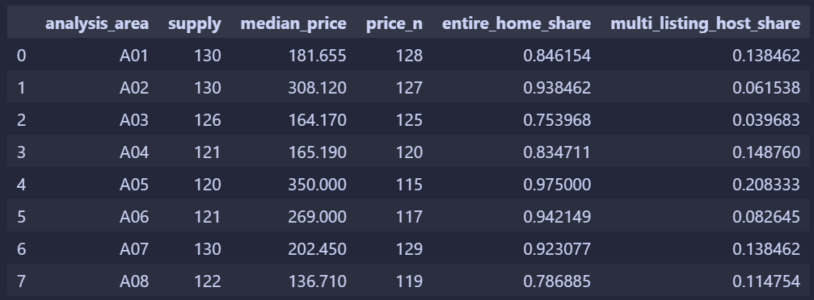
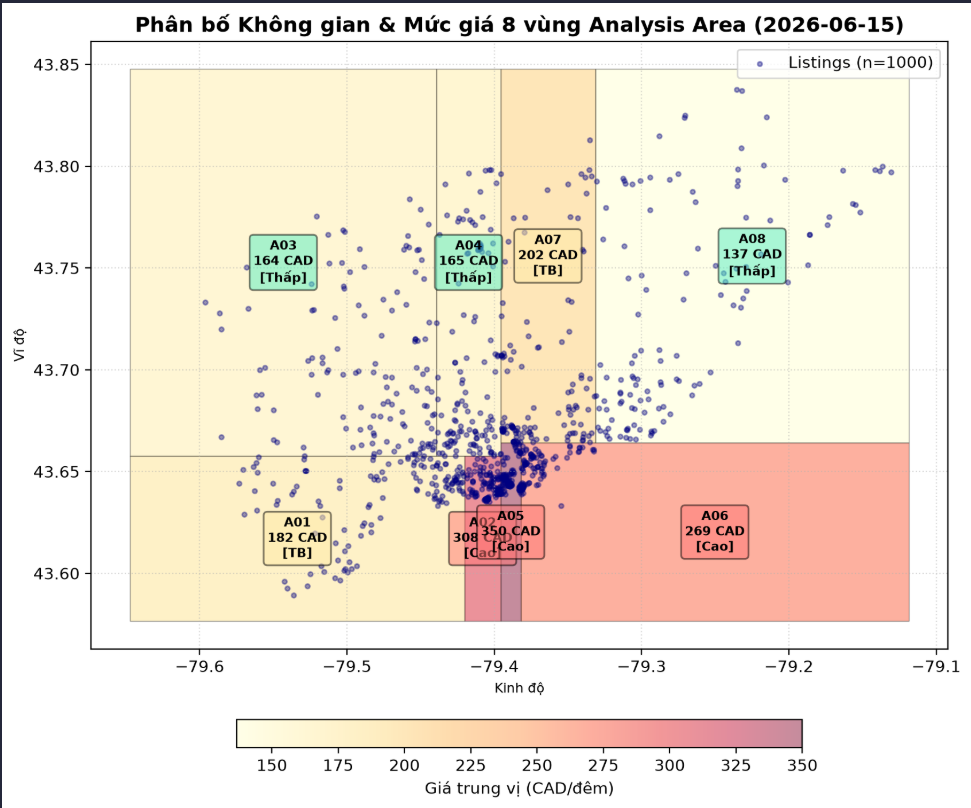
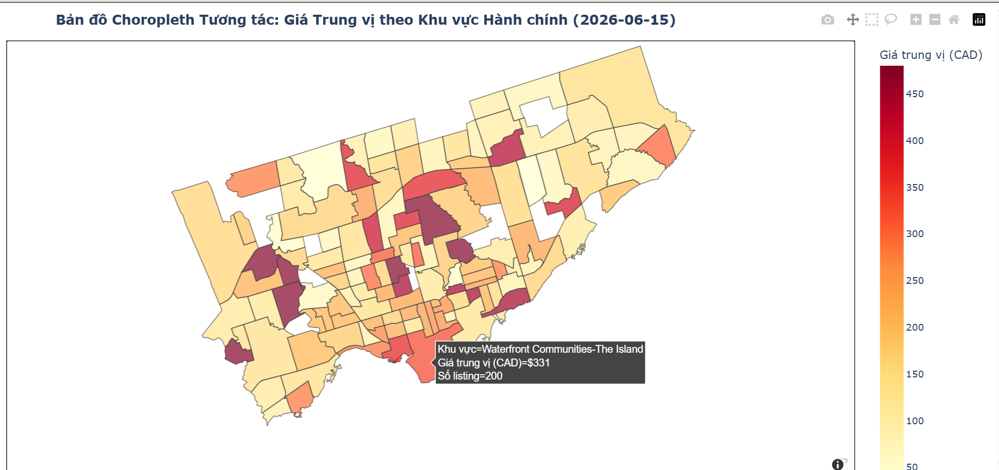
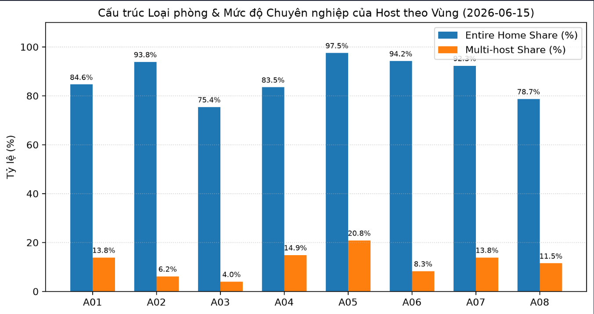

# BÁO CÁO PHÂN TÍCH KPI & TRỰC QUAN HÓA KHÔNG GIAN (TV3)

* **Thành viên thực hiện:** TV3 – Nguyễn Quốc Hiếu
* **Phạm vi sở hữu:** Phân tích KPI thị trường mốc snapshot cuối (`kpi.py`), trực quan hóa dữ liệu không gian (`viz_spatial.py`), và hệ thống Unit Test (`tests/test_kpi.py`, `tests/test_listings.py`).
* **Mốc dữ liệu phân tích:** `snapshots[-1]` ($t_{\text{latest}} = \text{2026-06-15}$).
* **Đơn vị tiền tệ:** CAD ($).

---

## 1. Phương pháp luận & Công thức Toán học (Formulas & Metrics)

Toàn bộ chỉ số KPI được tính toán dựa trên phân vùng không gian $8$ ô (`analysis_area` từ A01 đến A08) ở mốc snapshot mới nhất.

### 1.1. Nguồn cung & Mức giá Trung vị (Supply & Median Price)
* **Tổng nguồn cung ($N_{\text{supply}}$):** Tổng số lượng listing hiện diện tại mốc thời gian phân tích:
  $$N_{\text{supply}} = |\{ i \mid \text{listing}_i \in \text{snapshot}_{\text{latest}} \}|$$

* **Số lượng mẫu giá hợp lệ ($n_{\text{price}}$):** Số lượng listing có thông tin giá niêm yết không bị khuyết thiếu:
  $$n_{\text{price}} = |\{ i \mid p_i \neq \text{NaN} \land p_i > 0 \}|$$

* **Mức giá Trung vị ($P_{\text{median}}$):** Trung vị giá phòng theo từng phân vùng `analysis_area` tại mốc cuối (các mốc trước để trống theo Contract):
  $$P_{\text{median}} = \text{Median}\left(\{ p_i \mid i \in \text{valid\_price\_listings} \}\right)$$

### 1.2. Tỷ lệ Loại phòng Entire Home ($S_{\text{entire}}$)
Tỷ lệ phòng cho thuê toàn bộ căn hộ/nhà riêng trên tổng số listing có loại phòng hợp lệ trong từng vùng:
$$S_{\text{entire}} = \frac{\sum_{i=1}^{N_{\text{valid\_room}}} \mathbb{I}(\text{room\_type}_i = \text{'Entire home/apt'})}{N_{\text{valid\_room}}}$$

Trong đó:
* $\mathbb{I}(\cdot)$ là hàm chỉ thị (Indicator Function), nhận giá trị $1$ nếu điều kiện đúng và $0$ nếu sai.
* $N_{\text{valid\_room}}$ là mẫu số đếm các dòng có `room_type` hợp lệ ($\text{room\_type} \neq \text{NaN} \land \text{room\_type} \neq \text{''}$).

### 1.3. Tỷ lệ Host Chuyên nghiệp / Multi-listing ($S_{\text{multi}}$)
Mức độ chuyên nghiệp hóa của chủ nhà được xác định bằng tỷ lệ số listing thuộc sở hữu của các Host quản lý từ $2$ niêm yết trở lên tại mốc thời gian phân tích:
$$S_{\text{multi}} = \frac{\sum_{i=1}^{N_{\text{valid\_host}}} \mathbb{I}(\text{count}(\text{host\_id}_i) > 1)}{N_{\text{valid\_host}}}$$

Trong đó:
* $\text{count}(\text{host\_id}_i)$ là tổng số listing mà $\text{host\_id}_i$ sở hữu trong snapshot.
* $N_{\text{valid\_host}}$ là mẫu số các dòng có `host_id` hợp lệ ($\text{host\_id} \neq \text{NaN} \land \text{host\_id} \neq \text{''}$).

---

## 2. Danh mục File Đầu ra & Cấu trúc Module (Artifacts & File Deliverables)

| STT | File Path | Loại File | Chức năng / Mô tả |
|---|---|---|---|
| 1 | `src/airbnb/kpi.py` | Python Module | Triển khai hàm `summarize(listings, cfg)` và `df_kpi()`. Trả về `list[dict]` chứa các chỉ số KPI chuẩn hóa theo Contract. |
| 2 | `src/airbnb/viz_spatial.py` | Python Module | Triển khai hàm `render(tables, figures, cfg)`. Xuất $3$ hình ảnh/bản đồ không gian, trả về `list[Path]`. |
| 3 | `tests/test_kpi.py` | Pytest  | Kiểm thử $8$ trường hợp biên (edge cases): missing/invalid price, $0$ mẫu hợp lệ, host trống, nhóm rỗng, nhiều snapshot, mẫu số và unjoined area. |
| 4 | `tests/test_listings.py` | Pytest| Kiểm thử tích hợp hàm `summarize` và `render` với mock data và thư mục tạm `tmp_path`. |
| 5 | `figures/viz1_median_price.png` | Output Image (.png) | Bản đồ phân bố vị trí listing và giá trung vị theo $8$ phân vùng `analysis_area`. |
| 6 | `figures/viz2_choropleth.html` | Output HTML (.html)| Bản đồ Choropleth tương tác tô màu ranh giới hành chính `neighbourhood_cleansed`. |
| 7 | `figures/viz3_compare.png` | Output Image  (.png)| Biểu đồ cột so sánh tỷ lệ `Entire Home Share` và `Multi-host Share` giữa các phân vùng. |

---

## 3. Kết quả Trực quan hóa & Phát hiện Chính (Key Findings & Visualizations)


### 3.1. Phân bố Giá niêm yết theo Phân vùng Không gian (`viz1_median_price.png

* **Đặc điểm:** Kết hợp ranh giới $8$ phân vùng hình học (`analysis_area` A01–A08) cùng các điểm tọa độ tĩnh của niêm yết và dải màu đệm thể hiện mức giá.
* **Phát hiện chính:**
  * Vùng **A02** và **A05** (khu vực lõi trung tâm thành phố Toronto và dải ven hồ) ghi nhận mức giá trung vị cao nhất toàn thị trường ($P_{\text{median}} > 300\text{ CAD/đêm}$).
  * Vùng **A08**, **A03** và **A04**  ở phía Đông và Tây Bắc có mức giá mềm hơn đáng kể ($P_{\text{median}} \approx 137 - 165\text{ CAD/đêm}$).

### 3.2. Bản đồ Choropleth Tương tác Hành chính (`viz2_choropleth.html`)

* **Đặc điểm:** Bản đồ Chloropleth Mapbox cho phép tương tác trực quan (zoom, hover) hiển thị mật độ nguồn cung và giá trung vị theo $125$ phường xã hành chính (`neighbourhood_cleansed`).
* **Phát hiện chính:**
  * Mật độ niêm yết tập trung cao độ tại phường *Waterfront Communities-The Island (200)* và *Niagara (46)*  do nằm trực diện hồ Lake Ontario, có cảnh quan đẹp nhất thành phố, dông dân cư, nhiều tiện ích xã hội và là đầu mối giao thông công cộng với các nhà ga, sân bay
  *  Càng gần khu vực lõi trung tâm (giải mép phía Nam giáp với hồ Lake Ontario), cả số lượng chỗ ở và giá trung vị đều có xu hướng cao hơn. Điều này phản ánh đúng tính chất của khu vực này. Những vùng khác có giá trung vị lớn nằm ngoài vung này trên bản đồ chủ yếu là do số lượng listings quá ít, chưa đủ kết luận. 

### 3.3. Cấu hình Loại phòng & Mức độ Chuyên nghiệp của Host (`viz3_compare.png`)

* **Đặc điểm:** Biểu đồ cột đôi thể hiện song song hai tỷ lệ $S_{\text{entire}}$ và $S_{\text{multi}}$ theo từng phân vùng $A01 - A08$.
* **Phát hiện chính:**
  * **Cấu trúc loại phòng:** Tỷ lệ $S_{\text{entire}}$ chiếm ưu thế tuyệt đối ở hầu hết các vùng trung tâm ($> 85\%$), cao nhất tại vùng A05 ($97.5\%$). Điều này thể hiện xu hướng thương mại hóa cao của thị trường lưu trú ngắn hạn Toronto.
  * **Mức độ tích tụ của Host:** Tỷ lệ Host sở hữu nhiều niêm yết ($S_{\text{multi}}$) dao động từ $4\%$ đến $20.8\%$, trong đó vùng A05 có tỷ lệ host chuyên nghiệp cao nhất ($20.8\%$).

---

## 4. Giới hạn Nghiên cứu (Limitations)

1. **Phạm vi Mẫu dữ liệu:** Các chỉ số KPI được tính toán trên tập mẫu dữ liệu được giao (4000 listings), không đại diện toàn bộ quy mô tổng thể thị trường Airbnb toàn thành phố Toronto.
2. **Tính Đơn thời điểm của Giá:** Mức giá trung vị $P_{\text{median}}$ chỉ được tính toán tại mốc snapshot cuối cùng ($t_{\text{latest}}$). Các mốc lịch sử trước đó được giữ nguyên giá trị trống (`None`) để tuân thủ thiết kế Contract hệ thống.
3. **Đơn giản hóa Ranh giới Không gian:** Phân vùng `analysis_area` (A01 - A08) dựa trên các ô lưới hình học cố định (Bounding Boxes), do đó một số listing nằm gần ranh giới giữa các ô có thể bị phân loại ranh giới cứng thay vì theo địa lý kinh tế tự nhiên.
```

---

Báo cáo `reports/sections/tv3.md` đã được hoàn thiện đúng cấu trúc yêu cầu, chuẩn hóa toán học LaTeX và bao phủ đầy đủ tất cả các nội dung từ công thức, danh mục file đầu ra, phát hiện chính tới giới hạn nghiên cứu!